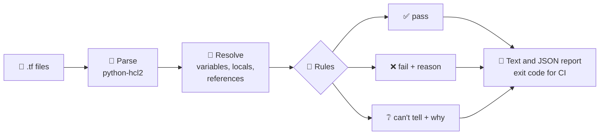

# iac-check-kit

[](https://github.com/builtbyshailendra/iac-check-kit/actions/workflows/checks.yml)


**Reads Terraform, checks it for two common security mistakes, and says what passed, what failed and why, in plain words.**

> Personal learning project. Every bucket, CIDR and account here is made up.

```text
$ python -m iac_check check ../samples/flawed_public_bucket
iac-check: ../samples/flawed_public_bucket (4 resources)

s3-public-access-block: S3 buckets block public access
  FAIL    aws_s3_bucket.assets  main.tf:19
          No public access block for this bucket, and none at account level
  FAIL    aws_s3_bucket.uploads  main.tf:23
          block_public_policy and restrict_public_buckets are off (aws_s3_bucket_public_access_block.uploads)

no-open-ssh: SSH (port 22) is not open to the whole internet
  PASS    aws_security_group.web  main.tf:36
          No ingress rule opens SSH to the whole internet

1 passed, 2 failed, 0 can't tell
```

## Why

When Terraform is written quickly, by a person or by a model, two mistakes turn up again and again: a bucket that can be made public, and SSH open to the whole internet. Both are valid Terraform, so `terraform validate` won't catch them. This kit reads the `.tf` files, checks those two rules, and writes a report that a person can read and CI can gate on.

## How it works



| Step | File | What it does |
|---|---|---|
| Parse | [`parse.py`](src/iac_check/parse.py) | Reads every `.tf` file in a folder, keeps resources, variables and locals together, and records the line each resource starts on |
| Resolve | [`parse.py`](src/iac_check/parse.py) | Follows `var.x` to its default, `local.x` to its value, and `aws_s3_bucket.logs.id` to the bucket. Anything that needs Terraform to evaluate becomes "can't tell" |
| Rules | [`rules/`](src/iac_check/rules) | Each rule returns one finding per resource: pass, fail or can't tell, with a reason |
| Report | [`report.py`](src/iac_check/report.py) | One result, two views: text for a terminal, JSON for a script. Exit code 1 when anything fails |

## The rules

| Rule | Fails when | Passes when |
|---|---|---|
| `s3-public-access-block` | A bucket has no public access block at bucket or account level, or any of the four settings is off | All four settings are on, from the bucket's own block, the account's, or both combined |
| `no-open-ssh` | A TCP or all-protocol ingress rule covers port 22 from any `/0` CIDR (`0.0.0.0/0` or `::/0`) | Every ingress rule is narrower: other ports, UDP only, or a specific CIDR |

The SSH rule reads all three ways the AWS provider lets you write ingress: `ingress` blocks inside `aws_security_group`, `aws_security_group_rule`, and `aws_vpc_security_group_ingress_rule`.

## A fair check passes a different correct answer

The first version of a check usually looks for one way of writing the right answer. That's not the same as checking that the answer is right.

`samples/good_alternative` is as safe as `samples/good`, but written differently:

- Public access is blocked once for the whole account, with no block next to each bucket.
- SSH rules live in separate resources instead of inside the security group.
- The SSH source is a single `/32` address, held in a local that reads a variable.
- An IPv6 office range is allowed on ports 20 to 25, which includes 22 but isn't the whole internet.

A check that only looked for an `aws_s3_bucket_public_access_block` beside each bucket would fail both buckets there, even though AWS would block public access. So the rules here follow three habits:

1. **Accept every way of writing the safe setup**, not only the most common one.
2. **Follow variables and locals** to the value they actually hold.
3. **Say "can't tell" instead of guessing.** When an answer depends on something only Terraform knows at plan time, such as a variable with no default, the finding says which value it couldn't work out. `--strict` turns those into failures when that's the safer choice.

The same idea applies to any grader, including one that checks code written by a model: check the outcome, not the wording.

## Samples

| Folder | What it is | Expected |
|---|---|---|
| `samples/good` | A log bucket with public access blocked, SSH only from the office CIDR | Pass |
| `samples/good_alternative` | The same safe setup written a different way (see above) | Pass |
| `samples/flawed_public_bucket` | One bucket with no public access block, one with only half the settings on | Fail |
| `samples/flawed_open_ssh` | SSH from `0.0.0.0/0`, once directly and once by opening every port | Fail |

Every sample passes `terraform validate`. The flawed ones are valid Terraform; they just aren't safe.

## Run it

```bash
pip install -r requirements.txt
cd src
python -m iac_check check ../samples/flawed_open_ssh
python -m iac_check check ../samples/good --json ../reports/good.json
```

| Exit code | Meaning |
|---|---|
| 0 | Nothing failed |
| 1 | At least one finding failed (or was "can't tell" with `--strict`) |
| 2 | The folder has no `.tf` files, or one of them can't be parsed |

Tests (also run by GitHub Actions on every push, together with `terraform validate` on every sample):

```bash
pytest -q
```

## What it can't do

- It reads the text and doesn't run `terraform plan`. Values from functions, `for_each`, modules and data sources come out as "can't tell".
- It doesn't follow `module` blocks into other folders.
- Two rules, AWS only.

## Build log

Built on 13 November 2026, one step at a time.

### Step 1: samples

**Built:** three small stacks, one good and two flawed, each a valid root module pinned to the AWS provider 6.x.

### Step 2: read the Terraform

**Built:** a loader that reads every `.tf` file in a folder with `python-hcl2`, plus a `list` command.

**Learned:** python-hcl2 version 8 keeps the quote marks inside string values by default, so a bucket name comes back as `"demo-app-logs"`, quotes included. One serialization option strips them. References like `var.office_cidr` come back as text such as `${var.office_cidr}`, so the loader follows variable defaults and locals itself, and marks anything it can't follow without running Terraform as unknown instead of guessing.

### Step 3: rule 1, buckets block public access

**Built:** a small rule framework (each rule returns one finding per resource: pass, fail or unknown, with a reason) and the first rule. A bucket passes when all four public access settings are on. They can come from the bucket's own block, an account-level block, or both, because AWS applies whichever is stricter. A setting that's left out counts as off, since that's the provider default.

**What broke:** findings pointed one line above the resource. The line search used `^\s*resource`, and `\s*` also matches a newline, so it started on the blank line before the block. Changing it to `^[ \t]*` fixed it, and a test now checks the line.

### Step 4: rule 2, no SSH open to the whole internet

**Built:** the second rule. It reads all three ways the AWS provider lets you write ingress. A rule fails when it allows TCP (or every protocol) on a port range that includes 22, from a CIDR with a `/0` prefix, so both `0.0.0.0/0` and `::/0` count.

**Learned:** the easy version only looks for `from_port = 22` and `"0.0.0.0/0"` side by side. That misses protocol `-1` (every port), a range like 20-25, TCP written as `"6"`, IPv6, and an open CIDR hidden behind a variable. Each of those now has its own test.

### Step 5: JSON report and command line

**Built:** `python -m iac_check check <folder>` runs every rule and prints a short report. `--json FILE` also writes the same result as JSON, with pass, fail and "can't tell" counts per rule. The exit code is 1 when anything fails, so CI can gate on it. `--strict` makes "can't tell" fail too.

**What broke:** a test expected the bastion finding on line 31. I had copied that number from the output before the line fix in Step 3. The file shows it on line 32, so the test was wrong, not the code.

### Step 6: CI

**Built:** a GitHub Actions workflow with two jobs. One runs the tests. The other installs Terraform 1.17.1, runs `terraform validate` on every sample, then grades them: the good sample must pass, and each flawed sample must fail with exit code 1. The JSON reports are uploaded as a build artifact.

**Decision:** in a GitHub Actions `run` step, bash stops at the first failing command. A flawed sample is supposed to fail, so the step catches the exit code with `|| code=$?` and checks it is exactly 1. A crash (exit 2) or an unexpected pass (exit 0) both fail the job.

### Step 7: a fair check

**Built:** `samples/good_alternative`, the same safe setup written a different way, and the write-up above. CI now requires both good samples to pass.

**Result:** the rules already passed it, because Steps 3 and 4 were written to accept the account-level block, separate rule resources and values behind locals. The sample now guards that: a future change that only recognises one style of writing will fail CI.

**Fixed while writing this up:** a `.tf` file with a syntax error crashed Python, and a crash also exits with code 1. CI would have read that as "the flawed sample failed, as expected". Parse errors now exit 2 with a one-line message, and a test covers it.

## Next

- A rule for unencrypted storage (EBS volumes and RDS instances)
- Read `terraform show -json` plan output, so values from functions and modules are known
- SARIF output, so findings show up in GitHub's code scanning tab
